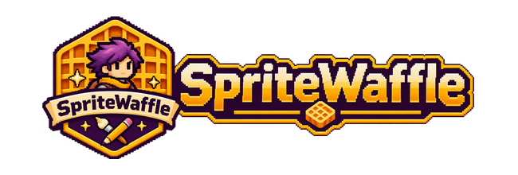
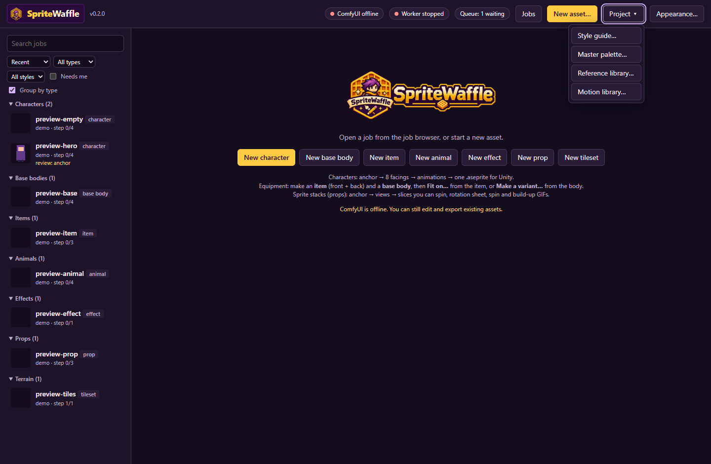
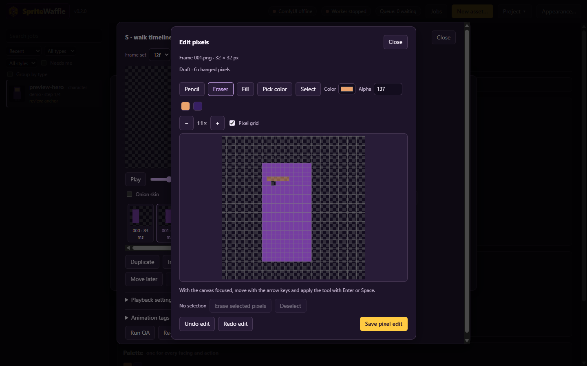
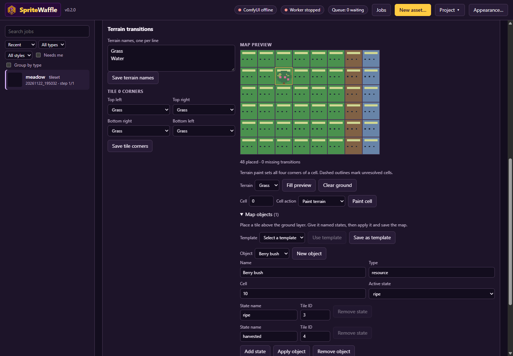

# SpriteWaffle



SpriteWaffle is a local studio for creating, editing, animating, and exporting 2D game assets.
Import your own artwork or connect a local ComfyUI installation for image and video generation.

- Create characters, standalone items, creatures, effects, props, and tilesets.
- Refine sprites with the pixel editor, animation timeline, and frame repair tools.
- Build terrain maps with animated tiles, collision, and reusable stateful objects.
- Export game-ready PNGs, atlases, Aseprite files, metadata, and portable Tiled maps.

## Screenshots

| Workspace and project tools | Pixel editor | Terrain and map objects |
| --- | --- | --- |
| [](docs/screenshots/workspace.png) | [](docs/screenshots/pixel-editor.png) | [](docs/screenshots/tileset-map.png) |

## Quick start

Install with Python 3.11 or later. From the repository on Windows, run the following.

```powershell
python -m venv .venv
.venv\Scripts\python -m pip install -r requirements-lock.txt
.venv\Scripts\python -m pip install -e . --no-deps
.venv\Scripts\spritewaffle ui
```

Open <http://127.0.0.1:8765> and choose **New asset**. On Windows, `.venv\Scripts\spritewaffle shortcut`
adds Desktop and Start Menu shortcuts that start the app (`--remove` takes them away). Editing and
export work locally without ComfyUI. Set up [ComfyUI](docs/COMFYUI_SETUP.md) when you want to generate artwork.

## Documentation

- [Wiki](docs/wiki/Home.md) and [getting started](docs/wiki/Getting-Started.md)
- [Studio guide](docs/wiki/Studio-Guide.md) and [asset workflows](docs/wiki/Workflows.md)
- [CLI and MCP reference](docs/wiki/Interfaces.md) and [agent installation](AGENT_INSTALL.md)
- [Changelog](CHANGELOG.md), [roadmap](docs/UPGRADE_ROADMAP.md), and [UI audit](docs/AUDIT_UI_2026-11-22.md)

## License

SpriteWaffle is source-available under the [MIT License with Commons Clause v1.0](LICENSE.md).
You can use it to create and sell games, art, and asset packs without SpriteWaffle royalties.
The license restricts selling SpriteWaffle itself or selling a service whose value derives
substantially from its functionality. Third-party models and imported artwork have their
own terms. See the [licensing guide](docs/LICENSING.md).
